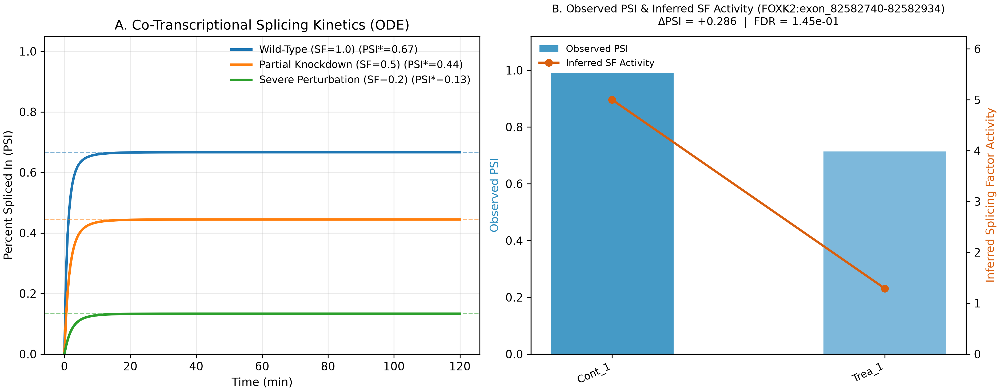
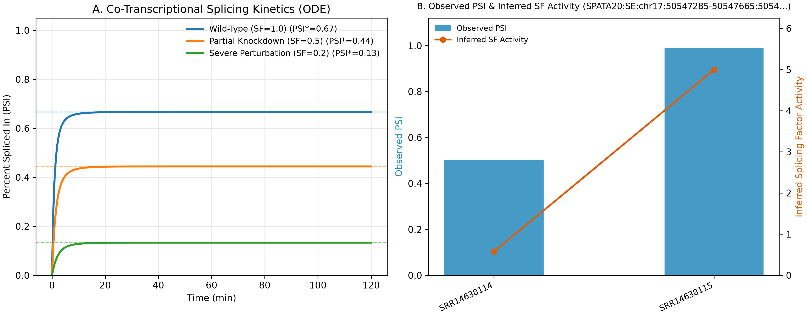

# Co-Transcriptional Alternative Splicing Kinetics & Splice-Graph GNN Pipeline (`splicing-kinetics-ode`)

An end-to-end **Snakemake**, **Python**, **SciPy**, and **PyTorch (`GATv2`)** bioinformatics pipeline that quantifies exon-skipping Percent Spliced In ($\text{PSI}$) from **short-read Illumina** and **long-read PacBio HiFi / Oxford Nanopore** RNA-seq data and infers Splicing Factor ($\text{SF}$) activity and isoform-specific mRNA degradation kinetics ($k_{\text{deg,inc}}, k_{\text{deg,skip}}$) via a **5-state co-transcriptional ODE model** and **Hybrid Splice-Graph GNN**.

---

## Key Features

* **Adaptive Compute Profiles (`mode=laptop|hpc`):** Automatically scales CPU threads, RAM caps (`--limitBAMsortRAM`, `--genomeSAsparseD`), node-local scratch (`$TMPDIR`), and Slurm cluster execution from an 8 GB laptop to a multi-node HPC cluster.
* **Multi-Platform RNA-seq Support (`platform=short|long`):**
  * **Short-Read Illumina (`platform=short`):** `fastp` QC (with automatic read-length detection) $\rightarrow$ `STAR` splice-aware alignment $\rightarrow$ two-group differential `rMATS-turbo` (`--b1` Control vs. `--b2` Treatment, computing $\Delta\text{PSI}$ and $\text{FDR}$).
  * **Long-Read PacBio HiFi & ONT (`platform=long`):** `minimap2` (`-ax splice:hq` or `-ax splice`) $\rightarrow$ `IsoQuant` (`mode=hpc`) / `StringTie2 -L` (`mode=laptop`) isoform quantification $\rightarrow$ `SUPPA2` event-level $\text{PSI}$.
* **5-State Co-Transcriptional ODE & Closed-Form Solver (`src/splicing_ode.py`):** Models sequential multi-exon commitment ($P_1 \rightarrow P_2 \rightarrow P_3 \rightarrow M_{\text{inc}}$ vs. $M_{\text{skip}}$), cooperative Hill binding kinetics, isoform-specific mRNA degradation ($k_{\text{deg,inc}} \neq k_{\text{deg,skip}}$), and $O(1)$ closed-form analytical inversion.
* **Hybrid Splice-Graph GNN + ODE (`src/gnn_kinetics.py`):** Pure-PyTorch 2-layer Graph Attention (`GATv2`) network over genomic exon–junction splice graphs coupled to a differentiable 5-state ODE steady-state layer (`--backend auto|scipy|gnn`).

---

## Mathematical Formulation

### 1. 5-State Co-Transcriptional ODE System
$$\frac{dP_1}{dt} = k_{\text{tx}} - k_{\text{commit}} P_1, \qquad \frac{dP_2}{dt} = k_{\text{commit}} P_1 - \big(k_{\text{splice}}(\text{SF}) + k_{\text{skip}}\big) P_2, \qquad \frac{dP_3}{dt} = k_{\text{splice}}(\text{SF}) P_2 - k_{\text{mat}} P_3$$

$$\frac{dM_{\text{inc}}}{dt} = k_{\text{mat}} P_3 - k_{\text{deg,inc}} M_{\text{inc}}, \qquad \frac{dM_{\text{skip}}}{dt} = k_{\text{skip}} P_2 - k_{\text{deg,skip}} M_{\text{skip}}$$

where cooperative activator/repressor Hill kinetics govern co-transcriptional splicing:
$$k_{\text{splice}}(\text{SF}, I) = k_{\text{splice},0} \cdot \frac{(\text{SF}/K_a)^{n_a}}{1 + (\text{SF}/K_a)^{n_a} + (I/K_r)^{n_r}}$$

### 2. Closed-Form Steady-State $\text{PSI}^*$ & Analytical Inversion
$$\text{PSI}^*(\text{SF}) = \frac{k_{\text{splice}}(\text{SF}) / k_{\text{deg,inc}}}{k_{\text{splice}}(\text{SF}) / k_{\text{deg,inc}} + k_{\text{skip}} / k_{\text{deg,skip}}}$$

> **Model Identifiability & Regularization Note:** From steady-state mature RNA-seq $\text{PSI}^*$ alone, co-transcriptional splicing rates ($k_{\text{splice}}$) and post-transcriptional isoform turnover ($k_{\text{deg,inc}} / k_{\text{deg,skip}}$) enter as a coupled ratio. In `backend=scipy`, degradation rates are fixed ($k_{\text{deg,inc}} = k_{\text{deg,skip}} = 0.20\ \text{h}^{-1}$) to isolate effective splicing factor activity. In `backend=gnn`, splice-graph neighborhood message passing and L2 priors regularize isoform-specific degradation across coupled exons; incorporating time-resolved metabolic labeling (e.g., 4sU-seq) or intronic nascent read counts directly resolves absolute kinetic rates.

---

## Quick Start

### 1. Create Environment
```bash
conda env create -f environment.yml
conda activate splicing-kinetics
```

### 2. Short-Read Two-Group Differential Splicing (`mode=laptop`, `platform=short`)
```bash
snakemake --cores 2 --jobs 1 --config \
  mode=laptop \
  platform=short \
  control_samples="SRR4421449" \
  treatment_samples="SRR4421393" \
  build=hg38 \
  chrom=17 \
  genes="FOXK2,SNHG16" \
  backend=auto
```

### 3. Long-Read PacBio HiFi Isoform Splicing (`mode=laptop`, `platform=long`)
```bash
snakemake --cores 2 --jobs 1 --config \
  mode=laptop \
  platform=long \
  long_preset="splice:hq" \
  control_samples="SRR14638114" \
  treatment_samples="SRR14638115" \
  build=hg38 \
  chrom=17 \
  genes="SPATA20,TMEM98" \
  backend=gnn
```

### 4. Full-Genome HPC Cluster Execution (`mode=hpc`, Slurm)
```bash
snakemake --executor slurm --jobs 32 --config \
  mode=hpc \
  platform=short \
  control_samples="CTRL_1,CTRL_2" \
  treatment_samples="KD_1,KD_2" \
  build=hg38 \
  chrom=all \
  genes="SRSF1,SRSF3,PTBP1,FOXK2" \
  backend=gnn
```

---

## Verified Benchmark Comparison (`GRCh38`, `chr17`)

| Platform & Gene | Solver Backend | Observed PSI (`Ctrl -> Treat`) | Inferred SF (`Ctrl -> Treat`) | Isoform Degradation (`k_deg_inc` / `k_deg_skip`) | Steady-State `PSI*` (`SF=1.0 / 0.5 / 0.2`) |
| :--- | :--- | :---: | :---: | :---: | :---: |
| **Short-Read `FOXK2`** (`exon_82582740-82582934`) | **SciPy** (`closed-form`) | `0.990 -> 0.714` | `5.000 -> 1.289` | `0.200 / 0.200` (Fixed) | `0.67 / 0.44 / 0.13` |
| **Short-Read `FOXK2`** (`exon_82582740-82582934`) | **PyTorch GNN** (`GATv2`) | `0.990 -> 0.714` | `4.975 -> 0.610` | `0.132 / 0.304` (Learned) | `0.82 / 0.65 / 0.26` |
| **Long-Read `SPATA20`** (`SE:50547285-50548283`) | **SciPy** (`closed-form`) | `0.500 -> 0.990` | `0.578 -> 5.000` | `0.200 / 0.200` (Fixed) | `0.67 / 0.44 / 0.13` |
| **Long-Read `SPATA20`** (`SE:50547285-50548283`) | **PyTorch GNN** (`GATv2`) | `0.500 -> 0.990` | `0.518 -> 4.939` | `0.171 / 0.199` (Learned) | `0.70 / 0.48 / 0.15` |

*\*Note: Observed $\text{PSI}$ values are clipped to $[0.01, 0.99]$ for numerical stability; boundary values ($\text{PSI} = 0.990$) map to the upper $\text{SF}$ saturation bound ($\text{SF} \approx 5.0$), whereas intermediate $\text{PSI}$ regimes ($0.500, 0.714$) resolve interior Hill kinetics.*

---

## Visual Results

### Short-Read Illumina (`FOXK2`, `Control` vs. `SRSF1` Knockdown)


### Long-Read PacBio HiFi (`SPATA20`, Splice-Graph `GATv2` + 5-State ODE)

